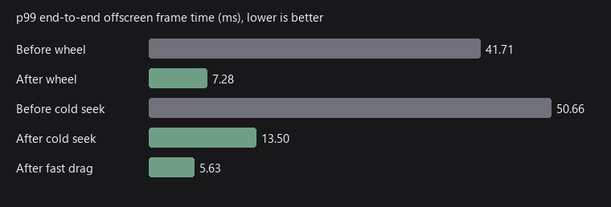

# Scrolling and idle performance

Default: **wgpu / D3D12**, iced automatic tiny-skia fallback. Screenshots remain tiny-skia/headless.

## 2560×1440 / 5,000-message scroll profile

Times in milliseconds. 60 warmups + 600 measured frames per trace. Software measurements rasterize the damaged chat region into a persistent pixmap; GPU measurements render the full offscreen texture and **wait for submission completion**, including driver/synchronization latency. No PNG encoding/readback or OS window. Offscreen traces use fractional wheel-sized offsets and randomized seek offsets, not a physical 280 Hz presentation measurement. Actual iced wheel/scrollbar pointer events are covered separately by the headless input test.

| Trace | Renderer | Layout p50 / p99 | Render p50 / p99 | End-to-end p50 / p99 |
|---|---|---:|---:|---:|
| Before (earlier) · wheel-deltas | tiny-skia | 0.98 / 4.36 | 19.07 / 20.68 | 20.45 / 24.07 |
| Before (earlier) · scrollbar-seek | tiny-skia | 4.43 / 7.04 | 19.68 / 27.46 | 27.27 / 37.89 |
| Before (load repeat) · wheel-deltas | tiny-skia | 1.70 / 9.54 | 27.14 / 34.19 | 30.27 / 41.71 |
| Before (load repeat) · scrollbar-seek | tiny-skia | 6.87 / 10.50 | 27.53 / 35.74 | 38.79 / 50.66 |
| After · wheel-deltas | wgpu-dx12 | 0.78 / 2.23 | 2.61 / 5.46 | 3.89 / 7.28 |
| After · scrollbar-seek | wgpu-dx12 | 5.65 / 8.24 | 1.45 / 5.78 | 7.63 / 13.50 |
| After · scrollbar-drag-skeleton | wgpu-dx12 | 0.18 / 0.76 | 0.85 / 5.24 | 1.19 / 5.63 |
| After software fallback · wheel-deltas | tiny-skia | 0.94 / 2.67 | 30.54 / 41.20 | 31.90 / 42.47 |
| After software fallback · scrollbar-seek | tiny-skia | 8.96 / 26.28 | 43.75 / 127.76 | 53.04 / 156.82 |
| After software fallback · scrollbar-drag-skeleton | tiny-skia | 0.28 / 1.03 | 22.31 / 28.05 | 22.78 / 28.67 |

[Earlier before raw](scroll-before.json) · [Before under-load repeat](scroll-before-contended.json) · [After GPU raw](scroll-after-gpu.json) · [After software raw](scroll-after-tiny.json)

The owner continued using the PC; system load was not controlled. The first final-revision run coincided with concurrent builds and a later ~83% total CPU sample: [GPU run 1](scroll-run1-gpu.json), [software run 1](scroll-run1-tiny.json). An earlier GPU prototype measured wheel total p50/p99 1.22/2.35 ms and render p99 1.86 ms, but **that is not this executable**. Both earlier and repeated baselines are preserved; do not infer a controlled causal speedup ratio or 280 Hz certification from unlike background loads.

### Bottlenecks and changes

- Software rasterization was the dominant cost (~19 ms median at this resolution), not attachment decoding. Random cold seeks additionally recreated/shaped message text and recalculated geometry.
- Default GPU rendering substantially reduces the software fill/raster bottleneck; it does not guarantee the requested final p99 target under concurrent load. D3D12 measured less residency than Vulkan and GL on this machine. Windows defaults to D3D12 without overriding an explicitly selected backend; GPU initialization failure follows iced's built-in software fallback. No animation/render ticker was introduced.
- Persistent, bounded **256-body shaped-paragraph + layout LRU** stores iced Trees across virtualization. Normal scroll hits reuse cosmic-text paragraphs/layout; content/spoiler/mention changes or width changes invalidate appropriately. Global stream sequence/typing/presence no longer invalidate message geometry. Keyed rows preserve normal widget continuity.
- Only visible message widgets + **four-row overscan** are built. Prefix heights use binary-search range lookup; per-pixel scrolling no longer reconstructs a full-history reference vector to render or resolve images.
- Static avatar/two-bar skeletons for missing/unlaid-out rows during fast movement; no shimmer. Viewport jumps **or event-rate-independent velocity** select the fast path, including small high-Hz scrollbar deltas. Evicted shaped-body entries also use placeholders instead of re-shaping while dragging. One event-driven **60 ms** settle timer (no idle polling) defers cold text preparation and image requests. The drag-skeleton trace measures that movement path; the cold-seek trace deliberately renders real content immediately and exposes remaining cold-layout cost. Do not treat these as identical workloads or claim the cold cost vanished.
- Thumbnail network/cache reads and image decode remain on bounded async/blocking workers; decoded RGBA handles are reused. No automatic original downloads.
- Up to **20,000 compact visited-message metadata entries** preserve IDs/heights/author/time through the **1,000-body / 8 MiB** content cap. Known evicted regions request the landing page directly, not intervening pages; stale seek results are rejected. Reload/index anchoring is regression-tested; prepend uses height-delta compensation. Current protocol exposes exclusive before/after IDs, **not total count/index/offset**: arbitrary jumps into never-visited history cannot be implemented honestly in the permitted client-only scope. Unknown older history still paginates normally.
- Native iced pixel/line deltas and thin 4px overlay scrollbars are retained. Subpixel sensor noise is ignored to prevent perpetual redraw feedback.

**Acceptance:** the table reports the final measured p99s, not a promise of <4 ms under concurrent system load. Physical foreground 280 Hz cadence remains unverified; cold content preparation still has a distinct cost after landing.

## Native idle residency

Real native processes, guarded non-primary/no-activation placement, ten-second warmup then 60 one-second samples. CPU uses one logical core, not all-core-normalized. Windows counter resolution applies. Each process is closed in `finally`; no trim/suspend tricks. The owner was using the PC, so GPU/desktop load was not controlled.

| Workload | Mean / max WS (MiB) | Mean private (MiB) | One-core idle CPU | Raw |
|---|---:|---:|---:|---|
| GPU · 2560×1440 | 135.42 / 136.94 | 158.57 | 0.051% | [JSON](perf-final-gpu.json) |
| Software fallback · 2560×1440 | 51.40 / 51.41 | 24.89 | 0.000% | [JSON](perf-final-tiny.json) |
| GPU · 5,000-history channel | 136.04 / 136.18 | 176.17 | 0.103% | [JSON](perf-final-history.json) |
| GPU · images | 115.87 / 116.11 | 158.05 | 0.026% | [JSON](perf-final-images.json) |

**The ~90 MB GPU target is not met on this PC.** GPU is retained for the measured scrolling improvement, not represented as meeting the old <60 MB budget. Preliminary D3D12/Vulkan/GL comparison records remain in `perf-*-prototype.json`; those are an earlier prototype, not this executable. Do not compare process working set to GPU VRAM.

Final executable: 16,251,392 bytes; SHA-256 `9866F2DA2B20CA65DB969E6BBDEA3E9B6B05EBCE108D362A10C5241EE3FBD949`.
Final idle records all match this executable. [History bounds](perf-final-history-stats.json). Placement/foreground records: [GPU](perf-final-placement-gpu.json), [fallback](perf-final-placement-tiny.json), [history](perf-final-placement-history.json), [images](perf-final-placement-images.json).

### Limitations

No certification of physical 280 Hz cadence or live-server high-latency page loading. The frame benchmark intentionally holds 5,000 mock message bodies to isolate view/render cost; the native history workload separately verifies the production 1,000-body bound. The headless input test validates actual fractional wheel and scrollbar drag processing, not OS event delivery. Live TLS/WebSocket, maximal Unicode, image churn and all adversarial resource combinations remain unmeasured.

Reproduce with the commands in [README](README.md); native process sampler is `tools/measure.ps1`. All screenshots use `--mock --screenshots`, never a native capture window.
